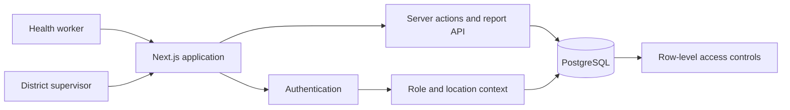

# RANOGO

### Digital infrastructure for access to essential services in Africa

## The problem RANOGO addresses

A field observation that helped shape RANOGO was the burden of carrying paper
medical records between providers. When someone changes clinics, their new care
team may have no direct access to previous test results or visit notes. The
patient may have to carry those documents and reconstruct their history.

Access to public benefits poses a similar coordination problem. A person may
have to pass documents between the office that confirms a life event, the
program that determines eligibility, and the organization that pays the benefit.
The processes vary by country and service.

## Objective

RANOGO aims to make it easier for people to continue their care across facilities
and access the health coverage and social benefits they qualify for. It would
give providers and public institutions a shared way to exchange relevant
information and track the steps that require coordination.

## Platform vision

- **Continuity of care.** A health record could follow a person throughout life.
  Clinics, hospitals, and laboratories could contribute information that authorized
  care teams need, such as visit notes, lab results, and care summaries.
- **Health insurance.** Facilities, pharmacies, and insurers could coordinate
  coverage verification, medication dispensing, and follow-up on covered care.
- **Social protection.** A birth confirmed by the civil registry could trigger an
  eligibility review for a public benefit. If approved, RANOGO could help track
  the payment made by a partner organization.

Identity helps connect each record to the right person. Public authorities remain
the official source for identity and civil registration. The same capabilities could support other public services over time.

## Platform building blocks

- **Identity and records.** Connect people to their health records and service
  cases, using official records where applicable.
- **Consent, access, and audit history.** Control who can see information and
  record how it was accessed or shared.
- **Case follow-up.** Track appointments, reminders, and steps that require
  action by a user, care team, or partner.
- **Connections to other systems.** Exchange relevant information with
  participating health providers, insurers, public programs, and payment partners.

## Initial rollout and risks

Benin and Burkina Faso are the planned first deployment countries.

Early risks include intermittent connectivity, adoption by frontline teams,
incorrect identity matching, and exposure of sensitive information on shared
devices. Deployment also depends on reliable notifications, compatibility with
existing systems, and the readiness of local partners.

## How the MVP fits

This public repository is a portfolio case study of the maternal-health MVP.
Using synthetic data, it illustrates how a health worker registers a patient with
consent and records an antenatal visit, and how a supervisor follows activity in
their district. It demonstrates a first application of the platform vision.

## The maternal-health problem

Frontline health teams often work across disconnected facilities with limited
visibility into patient follow-up. Supervisors need a reliable way to identify
overdue care, understand district workload, and support health workers without
weakening patient privacy.

## What the prototype covers

RANOGO brings the core workflow into one role-aware web application:

- Consent-gated patient registration and profile management
- Antenatal visit recording and longitudinal visit history
- Due-date, high-risk, and missed-visit notifications
- Facility-scoped workflows for health workers
- District dashboards and patient drill-down for supervisors
- Date-bounded CSV reporting with export auditing
- Connectivity-aware behavior that prevents unsafe writes while offline

## User journeys

### Health worker

1. Sign in to a facility-scoped workspace.
2. Register a patient after recording informed consent.
3. Record antenatal visits and review care history.
4. Use dashboard indicators and notifications to prioritize follow-up.

### District supervisor

1. Open a district-level operational overview.
2. Review patient, visit, and health-worker activity.
3. Investigate high-risk or overdue cases.
4. Export a bounded report for an authorized reporting period.

## Architecture overview

The application uses defense in depth: the interface adapts to the user's role,
server-side operations validate every request, and the database independently
enforces record visibility.

## Technology

- Next.js and React
- TypeScript
- Supabase Auth and PostgreSQL
- Tailwind CSS and a reusable component system
- Zod validation
- Vitest and Testing Library

## Engineering highlights

- **Consent by design:** patient access and clinical actions depend on current
  consent, rather than treating consent as presentation-only metadata.
- **Least-privilege access:** health workers are scoped to their facility while
  supervisors are scoped to their assigned district.
- **Operational safety:** report parameters, result sizes, and exports are
  bounded and validated.
- **Notification privacy:** stored alerts follow current patient-access rules.
- **Testable domain logic:** risk classification, reporting boundaries, dates,
  validation, notification behavior, and dashboard summaries are covered by
  automated tests.
- **Honest offline behavior:** the interface reports connectivity loss and
  blocks writes rather than implying that unsaved clinical data was queued.

## Security and privacy

This showcase intentionally excludes implementation details that would expose
security policy internals or proprietary product strategy. The private
codebase includes layered authorization, row-level data controls, input
validation, export safeguards, and audit records.

The prototype must not be used with real patient data or as a production
clinical system without independent security, privacy, regulatory, and
clinical-safety review.

## Current status

The maternal-health MVP includes health-worker and district-supervisor workflows for demonstration with synthetic data. The broader platform capabilities are future work.

Portfolio project by [victoued](https://github.com/victoued).
