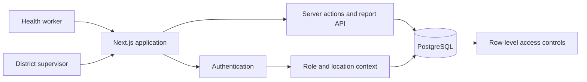

# RANOGO

### Digital infrastructure for community and maternal healthcare

RANOGO is a maternal-health case-management prototype designed for health
workers and district supervisors. It demonstrates how consent-aware digital
records, operational alerts, and district reporting can support continuity of
care across resource-constrained health facilities.

> This public repository is a portfolio case study. The application source,
> database policies, internal product strategy, infrastructure configuration,
> and Git history remain private.

## The problem

Frontline health teams often work across disconnected facilities with limited
visibility into patient follow-up. Supervisors need a reliable way to identify
overdue care, understand district workload, and support health workers without
weakening patient privacy.

## The prototype

RANOGO brings the core workflow into one role-aware web application:

- Consent-gated patient registration and profile management
- Antenatal visit recording and longitudinal visit history
- Due-date, high-risk, and missed-visit notifications
- Facility-scoped workflows for health workers
- District dashboards and patient drill-down for supervisors
- Date-bounded CSV reporting with export auditing
- Connectivity-aware behavior that prevents unsafe writes while offline

## User journeys

### Health worker

1. Sign in to a facility-scoped workspace.
2. Register a patient after recording informed consent.
3. Record antenatal visits and review care history.
4. Use dashboard indicators and notifications to prioritize follow-up.

### District supervisor

1. Open a district-level operational overview.
2. Review patient, visit, and health-worker activity.
3. Investigate high-risk or overdue cases.
4. Export a bounded report for an authorized reporting period.

## Architecture overview

The application uses defense in depth: the interface adapts to the user's role,
server-side operations validate every request, and the database independently
enforces record visibility.

## Technology

- Next.js and React
- TypeScript
- Supabase Auth and PostgreSQL
- Tailwind CSS and a reusable component system
- Zod validation
- Vitest and Testing Library

## Engineering highlights

- **Consent by design:** patient access and clinical actions depend on current
  consent, rather than treating consent as presentation-only metadata.
- **Least-privilege access:** health workers are scoped to their facility while
  supervisors are scoped to their assigned district.
- **Operational safety:** report parameters, result sizes, and exports are
  bounded and validated.
- **Notification privacy:** stored alerts follow current patient-access rules.
- **Testable domain logic:** risk classification, reporting boundaries, dates,
  validation, notification behavior, and dashboard summaries are covered by
  automated tests.
- **Honest offline behavior:** the interface reports connectivity loss and
  blocks writes rather than implying that unsaved clinical data was queued.

## Security and privacy

This showcase intentionally excludes implementation details that would expose
security policy internals or proprietary product strategy. The private
codebase includes layered authorization, row-level data controls, input
validation, export safeguards, and audit records.

The prototype must not be used with real patient data or as a production
clinical system without independent security, privacy, regulatory, and
clinical-safety review.

## Current status

The maternal-health workflow is an active MVP. The health-worker and supervisor
experiences are implemented; broader platform modules and production-readiness
work remain outside this public case study.

## Résumé summary

**RANOGO — Maternal Health Digital Platform**

Designed and developed a secure, role-based healthcare case-management MVP
using Next.js, TypeScript, PostgreSQL, and Supabase. The platform combines
consent-aware patient records, antenatal visit tracking, operational alerts,
district oversight, and audited reporting.

## Source access

The production source repository is private. A guided technical walkthrough
can be provided during an interview when appropriate.

---

Portfolio project by [victoued](https://github.com/victoued).
